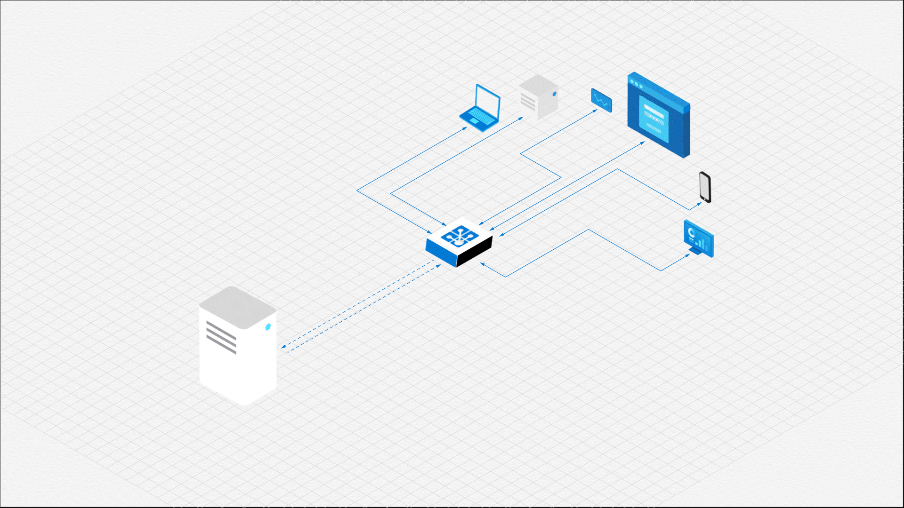
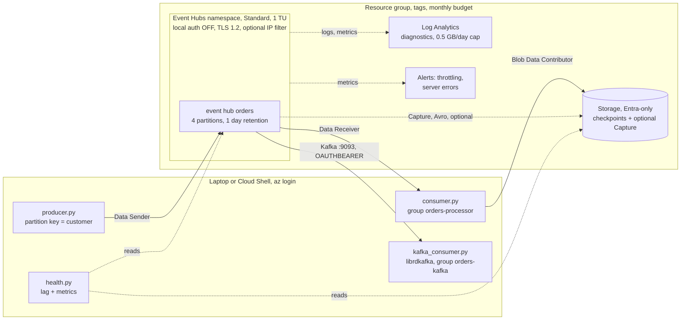

> Series "Golden pipeline" - Each POC represents my vision of a modern enterprise platform, exploring a different platform engineering decision: what to standardise, what to automate, what to delegate to managed services, and where teams should retain control.

# POC: Event ingestion on Azure Event Hubs with Terraform

An orders stream on **Azure Event Hubs**: a producer and a consumer group with durable
checkpoints, the **same stream read by an unchanged Kafka client**, **Entra ID only (no keys anywhere)**, alerts, a budget, policy-as-code in CI,
an **AI plan reviewer** and an **AI triage skill** for operations.

The question behind this POC: **how much of an event-streaming platform should you run yourself?**
The rest of the series asks it for compute
([poc-aws-eks-karpenter](https://github.com/ailves2009/poc-aws-eks-karpenter),
[poc-aws-eks-auto](https://github.com/ailves2009/poc-aws-eks-auto),
[poc-fargate](https://github.com/ailves2009/poc-fargate)); this one asks it for the data plane,
on a second cloud.

> **Status: validated offline, not deployed.** `terraform validate`, tflint, Checkov, the guardrails
> and the unit tests pass in CI. The environment has not been applied to Azure, so runtime behaviour
> (RBAC propagation, diagnostic categories, Kafka OAuth, metrics queries) is unverified, and every
> cost figure below is a list-price estimate.



## The decision in one page

Four Azure-native or common ways to move events, for one use case: *many producers send business
events; several independent consumers read them in order per key and can replay recent history.*

| Concern | Self-managed Kafka (Strimzi on AKS) | **Event Hubs Standard (this POC)** | Service Bus | Event Grid |
| ------- | ----------------------------------- | ---------------------------------- | ----------- | ---------- |
| Model | Partitioned log | Partitioned log, Kafka API compatible | Queue / topic, per-message state | Push notification of discrete events |
| Replay | Any offset within retention | Any offset within retention (1-7 days) | No; a message is consumed once | No |
| Ordering | Per partition | Per partition (partition key) | Sessions | None guaranteed |
| Independent readers | Consumer groups | Consumer groups (up to 20) | Subscriptions | Subscriptions |
| You operate | Brokers, KRaft, disks, upgrades, rebalancing | Throughput units and partitions | Nothing | Nothing |
| Auth | SASL/mTLS, your PKI | **Entra ID RBAC**, no secrets | Entra ID RBAC | Entra ID |
| Cost floor | Nodes + disks, 24/7 (hundreds USD/month) | **~$22/month** per TU | ~$10/month (Standard) | Per operation |

| Point of view | On one hand | On the other hand |
| ------------- | ----------- | ----------------- |
| **Business** | Streaming without a Kafka team; Kafka clients work unchanged | Azure lock-in for operations and pricing; not every Kafka feature exists on Standard (check the compatibility matrix) |
| **Operations** | Two knobs: throughput units and partitions | Partitions are immutable on Standard: the one decision you cannot undo |
| **Security** | Local auth off, RBAC per event hub, TLS 1.2: no key can leak because none exists | Public endpoint by default; private endpoints need a VNet design (not in this POC) |
| **Cost** | Fixed, small, predictable; auto-inflate off | Capture and Premium change the order of magnitude; TUs bill per hour, used or not |
| **Reliability** | 99.95% SLA (Standard), at-least-once, replay from retention | Ordering only per partition; consumers must be idempotent |

**Rule of thumb:** Event Hubs when you need a replayable log at modest scale and no Kafka team.
Service Bus when each message is a unit of work (retries, dead-letter, sessions). Event Grid for
fan-out of "something happened" notifications. Run Kafka yourself only for features or scale
the managed tiers do not give you, and price the team, not just the nodes.

## What gets deployed



| File | What it does |
| ---- | ------------ |
| [terraform/main.tf](terraform/main.tf) | Resource group, namespace (Standard, fixed TUs, local auth off), event hub `orders`, consumer group |
| [terraform/identity.tf](terraform/identity.tf) | Data-plane roles: Sender and Receiver separately, scoped to the event hub; Blob access scoped to one container |
| [terraform/checkpoints.tf](terraform/checkpoints.tf) | Entra-only storage for checkpoints and Capture, soft delete, blob access logs |
| [terraform/observability.tf](terraform/observability.tf) | Log Analytics with a daily cap, diagnostic settings, alerts on throttling and server errors |
| [terraform/budget.tf](terraform/budget.tf) | Monthly budget with actual and forecast notifications |
| [app/](app/) | `producer.py`, `consumer.py` (SDK + Blob checkpoints), `kafka_consumer.py` (plain Kafka client), `health.py`; pure logic in `core.py` |
| [policy/guardrails.py](policy/guardrails.py) | Policy as code: the review findings, enforced on every PR |

## How the requirements are met

**Ordering.** The producer uses `customer_id` as the partition key: all orders of one customer go to
one partition and are read in send order. Different customers are spread over 4 partitions.
There is no global order, and a design that needs one does not fit a partitioned log.

**Durable progress.** The consumer stores checkpoints in Blob Storage. Stop it, start it again, and
it continues where it stopped. Start two consumers and they split the partitions between them
through the same store: horizontal scale up to the partition count, with no coordinator to run.

**Kafka clients, unchanged.** [kafka_consumer.py](app/kafka_consumer.py) reads the same event hub
with `confluent-kafka` (librdkafka) on port 9093: the event hub is the topic, the partition key is the
message key. It authenticates with an Entra ID token (`OAUTHBEARER`), not a password, under the same
`Data Receiver` role. Its consumer group offsets are kept by the service, so it needs no checkpoint
store, and it reads independently of `consumer.py`. This is the answer to "do we need our own Kafka?":
the client side stays Kafka; the brokers become a managed service.

**At-least-once, made safe.** A checkpoint is written every 50 events and on shutdown. A crash in
between redelivers up to 50 events, so every event carries a `message_id` and processing must be
idempotent. Checkpointing more often means more storage writes; less often means more redelivery.

**Throughput and throttling.** 1 TU = 1 MB/s or 1000 events/s in. The producer batches events per
partition key, one network call per full batch, which keeps a single TU far from its limit in the
demo. Auto-inflate is off on purpose: hitting the limit raises an alert and a human decides,
instead of the bill growing on its own.

**Consumer lag.** Azure does not expose lag as a metric. `make health` computes it per partition
(last enqueued sequence number minus the checkpoint) and combines it with namespace metrics into
deterministic verdicts: `consumer_behind`, `hot_partition`, `throttled`, `near_capacity`, errors.

## The pipeline

```text
PR / push:  terraform fmt, validate, tflint ─┐
            Checkov (skips inline, with reasons) ─┼─► all must pass
            guardrails + pytest + ruff ───────────┘
PR, if Azure is configured:
            plan (OIDC, Reader) ─► plan_facts.py ─► Claude Code review ─► PR comment
```

There is no apply job: the environment lives for an afternoon, created and destroyed with `make`.
**Guardrails** ([policy/guardrails.py](policy/guardrails.py)) encode what the review of the 2023
version found, so it cannot come back: no SAS policies, local auth off, TLS 1.2, Standard SKU
only, auto-inflate off, no storage keys, no broad roles, cost tags on every billable resource.
Each rule has a test that proves it fires on the 2023 code ([tests/test_policy.py](tests/test_policy.py)).

## AI in this project

The principle of the series: **deterministic tools decide, the model explains.**

### Implemented: AI plan reviewer (CI)

On a PR, [ci/plan_facts.py](ci/plan_facts.py) turns the plan into posture facts: who gets which
role, how exposed the namespace is, whether any key-based auth exists, what drives the cost, and
a list of deterministic warnings. Claude Code (`claude -p`, `Read` tool only) explains them in a PR
comment. It may not drop or soften a warning. The AI job has no Azure credentials and no write
token; a separate job posts the comment. The prompt treats every string in the plan as data,
because resource names and tags come from the change under review.

### Implemented: triage skill (operations)

[.claude/skills/eventhub-triage](.claude/skills/eventhub-triage/SKILL.md) is a Claude Code skill
for "why are consumers behind?" questions. It runs `make health`, maps the verdicts to causes with
a fixed table (throttling, hot partition, too few consumers, partition ceiling, RBAC errors) and
proposes the smallest change as a diff with its monthly cost. It is read-only: applying is
`make plan` and `make up` by a human. [CLAUDE.md](CLAUDE.md) gives any agent in this repo the
same rules: no keys, least privilege, cost is a design input, never apply on its own.

**How the agents are secured**

| Risk | Control |
| ---- | ------- |
| The agent changes infrastructure | CI reviewer: no credentials, `Read` only. Skill: read-only commands; apply is a human step |
| Prompt injection via resource names, tags, event bodies, error texts | Prompts treat all inputs as data; outputs are comments and proposals, no decision depends on them |
| The model invents thresholds or "approves" | Verdicts and warnings are computed in code (`core.signals`, `plan_facts`, `guardrails`) |
| Secret leakage | There are no secrets: Entra ID everywhere, `.env` holds endpoints only |
| Supply chain | Claude Code CLI and every GitHub Action are pinned (version or commit SHA) |

### Roadmap (not in this POC)

| Agent | What it does |
| ----- | ------------ |
| **Lag autoscaler, advisory** | Watches `health.py` facts on a schedule, opens a PR to scale consumers or TUs with the cost delta |
| **Schema guardian** | Reviews producer changes against an Event Hubs schema group (Avro) and flags breaking changes |
| **Capture analyst** | Answers questions over the Capture archive (Avro in Blob) with a query engine, for replay and audits |

## Security

### ✅ Implemented

- **No keys:** `local_authentication_enabled = false` on the namespace, `shared_access_key_enabled = false`
  on storage. No SAS policies, no connection strings, nothing to rotate or leak.
- **Least privilege:** Sender and Receiver are separate roles on the single event hub; the consumer gets
  Blob access to the checkpoint container only; Capture writes with the namespace's managed identity to its
  own container.
- **Transport:** TLS 1.2 minimum on the namespace and storage; HTTPS only.
- **Network (optional):** IP allowlist on the namespace via `allowed_cidrs`.
- **Audit:** namespace logs and blob read/write/delete logs in Log Analytics.
- **Data protection:** blob and container soft delete (7 days).
- **Policy as code** and Checkov on every PR; every skipped check is justified inline.

### ⚠️ Not done in this POC: required in production

- **Private endpoints** for the namespace and storage, `privatelink.servicebus.windows.net` and
  `privatelink.blob.core.windows.net` DNS zones, public access off.
- **Workload identities:** separate managed identities (or AKS workload identity) for producer and
  consumer instead of the deploying user (the variables `producer_principal_id` and `consumer_principal_id` exist for this).
- **Remote state** with locking, and an apply pipeline with approval.
- **Customer-managed keys** where compliance requires them (Premium tier).
- **Geo-disaster recovery** (namespace alias pairing) and an availability-zone review.
- **Schema registry** and contract tests between producers and consumers.

## Cost

List prices, West Europe, November 2026, approximate. Check the
[pricing calculator](https://azure.microsoft.com/pricing/calculator/) before relying on them.

| Item | Price | This POC |
| ---- | ----- | -------- |
| Event Hubs Standard, throughput unit | ~$0.03/hour per TU | 1 TU ≈ **$22/month**, or under $0.10 for an afternoon |
| Ingress events | ~$0.028 per million | The demo sends 500 events: effectively $0 |
| Capture (optional) | ~$0.10/hour per TU | **+$73/month**: more than the namespace itself, so off by default |
| Storage, Log Analytics | cents at demo volume | Log ingestion capped at 0.5 GB/day |
| Not used: Basic | ~$0.015/hour per TU | No consumer groups, no Kafka, no IP filter: does not meet the use case |
| Not used: Premium | ~$1+/hour per PU | Hundreds of USD per month: isolation and scale a POC does not need |
| Not used: Stream Analytics | ~$0.11/hour per SU | ~$80/month, running 24/7: the reason it is on the roadmap, not here |

**Guardrails:** fixed TUs (validation allows 1-2), auto-inflate off and enforced by policy, a monthly
budget with actual and forecast alerts, a Log Analytics daily cap, and `make down`.

## Deploy

Prerequisites: Azure subscription with Owner (or Contributor + User Access Administrator) on it,
`az`, `terraform` >= 1.9, `python3` >= 3.11, `make`. Azure Cloud Shell has all of them.

```bash
git clone https://github.com/ailves2009/poc-azure-event-hub && cd poc-azure-event-hub
az login
cp terraform/terraform.tfvars.example terraform/terraform.tfvars   # optional: owner, alert_email, allowed_cidrs
make plan     # review what will be created
make up       # applies exactly that plan, writes .env (endpoints only)
```

## Verify

```bash
make send      # 500 orders, 25 customers, batched per partition key
make receive   # 30 s: claims partitions, prints a few events, checkpoints
make receive   # again: "nothing new", it resumed from the checkpoints
make kafka     # the same events again, through the Kafka protocol, in its own consumer group
make health    # JSON: lag per partition, metrics, verdicts
```

Things worth trying:
- `make send` then run `make receive` in **two terminals**: each consumer claims about half of the partitions.
- `cd app && ../.venv/bin/python producer.py --count 5000 --customers 1`: one hot key.
  `make health` reports `hot_partition`, and the triage skill explains why more TUs would not help.
- In Claude Code: *"are the consumers keeping up?"* triggers the `eventhub-triage` skill.

RBAC can take a few minutes to propagate after `make up`; a `401`/`403` right after deploy is expected.

## Destroy

```bash
make down
```

Everything, including the budget, alerts and diagnostic settings, lives in one resource group
and is destroyed with it. Billing stops when the namespace is gone.

## Trade-offs

- **Local state, no apply pipeline.** Right for a POC that lives for hours; wrong for anything shared.
- **The deploying user gets the data roles.** It keeps the demo one command; production uses two
  workload identities.
- **Public endpoint.** Entra ID makes it safe enough for a demo; private endpoints are the production answer.
- **4 partitions.** Enough to show parallelism and skew. In production, size partitions for the
  peak number of parallel consumers, because Standard cannot change them later.
- **Checkpoint every 50 events.** Visible redelivery in a crash test, few storage writes.

## History

This POC started in 2023 as a talk ([slides](docs/slides-2023.key)) and a minimal Terraform
deployment. [CHANGES.md](CHANGES.md) lists what the 2026 review found and how each finding was fixed;
[docs/slides-2023-errata.md](docs/slides-2023-errata.md) corrects the slides.
